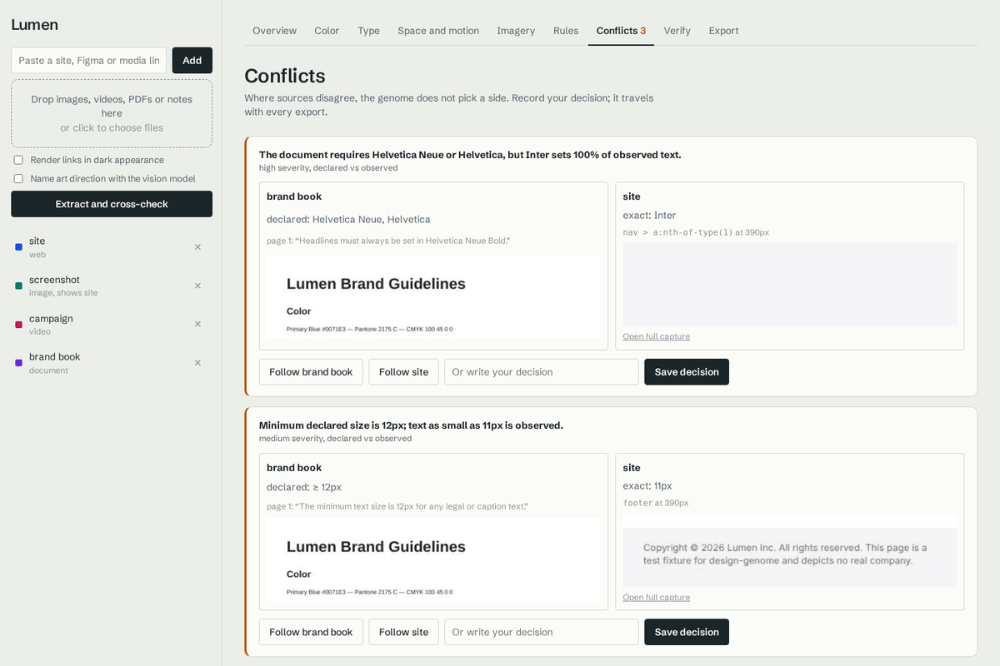
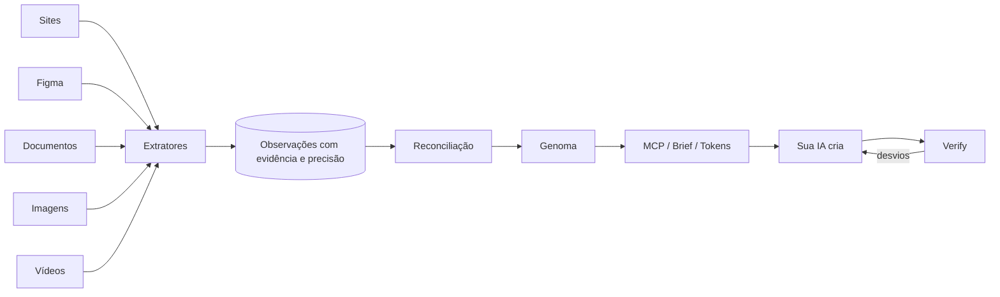
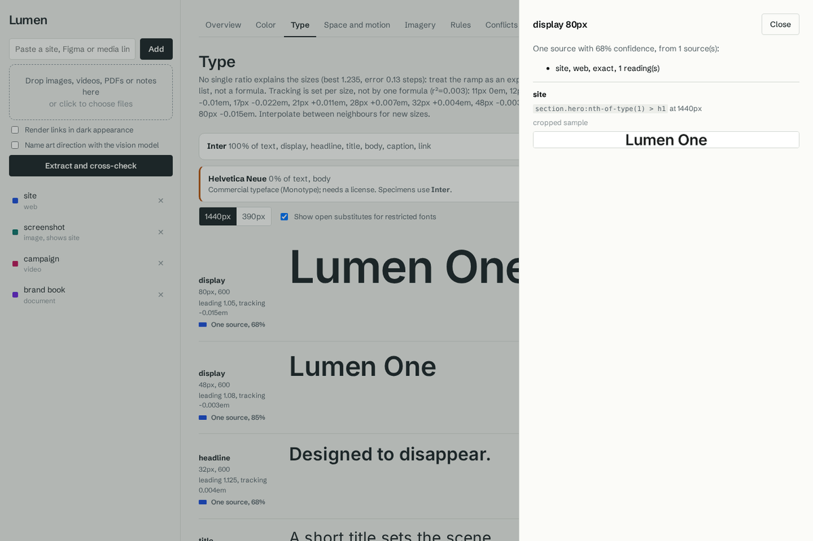

# Design Genome

**Engenharia reversa de design, com prova para cada fato.**

Você entrega sites, documentos, imagens, vídeos e arquivos do Figma de uma marca. O Design Genome mede cada fonte com a ferramenta certa, cruza tudo, mostra onde as fontes concordam e onde discordam, e entrega para a sua IA um "genoma" do sistema visual: tokens, regras, direção de arte e limites, cada item ligado à evidência que o produziu.

Depois, ele fecha o ciclo: mede o que a IA criou com os mesmos extratores e aponta cada desvio com o valor correto mais próximo.



A ideia vem do [REA](https://github.com/morluto/rea), que faz engenharia reversa de binários para agentes de IA. A lógica é a mesma, aplicada a design:

| REA (binários) | Design Genome (design) |
|---|---|
| Motores: Ghidra, Hopper, IDA | Motores: Chromium (CSS computado), API do Figma, leitor de PDF, ffmpeg, análise de pixels, modelo de visão |
| Evidência com hash, endereço e provider | Evidência com seletor, viewport, região da imagem, quadro do vídeo, página do PDF ou nó do Figma |
| Observado, derivado, inferido, desconhecido | Exato, declarado, estimado, inferido; o que ninguém viu fica como desconhecido |
| Cobertura ausente não é ausência | "Nenhuma fonte examinou movimento" em vez de "não há movimento" |
| Ferramentas de comparação | `verify`: nota de conformidade com cada desvio |
| Economia de tokens para o agente | Brief compacto e consultas por faceta via MCP |

## O que dá para absorver

| Fonte | Como é lida | Precisão | O que sai |
|---|---|---|---|
| **Link de site** | Chromium renderiza em vários viewports e lê o que o navegador calculou | exata | Cores, fontes realmente pintadas (via CDP), tamanhos, peso, entrelinha, tracking, espaçamentos, raios, sombras, transições e curvas, animações, breakpoints, largura de conteúdo, títulos |
| **Figma** | API REST (ou JSON exportado) | exata | Preenchimentos, estilos de texto, auto-layout, raios, sombras |
| **Documento** (PDF, Markdown, TXT, HTML) | Texto extraído e interpretado, em português e inglês | declarada | Paleta oficial com Pantone/CMYK, tipografia declarada, regras ("nunca", "sempre", "evite", "mínimo de 12px"), unidade de grid |
| **Imagem** | Análise de pixels em OKLab | estimada | Paleta com área e região, luminosidade, contraste, saturação, temperatura, espaço negativo, simetria, ponto focal, margens |
| **Vídeo** | ffmpeg: detecção de cortes, quadros por plano | estimada | Ritmo de montagem (duração de plano, cortes por minuto, regularidade), paleta e grade de cor por plano, intensidade de movimento |
| **Visão** (opcional) | O próprio Claude conectado via MCP olha as evidências já extraídas (sem chave de API); ou, sem o Claude, a API com `--vision` | inferida | Iluminação, ângulo e tamanho de plano, fundo, composição, tratamento tipográfico, regras de direção de arte |

Várias fontes da mesma marca se reforçam. Fontes de marcas diferentes podem ser combinadas num mesmo projeto para criar um genoma híbrido.

### Links do Behance e de galerias

Cole o link e pronto: o Design Genome baixa tudo sozinho.

- **Projeto do Behance** (`behance.net/gallery/...`): todas as imagens na maior resolução disponível, as grades de imagens, os vídeos do player da Adobe e do Vimeo (salvos em MP4), a capa dos vídeos do YouTube e os textos do projeto. Cada arquivo vira uma fonte "filha" do projeto, com o link de origem guardado.
- **Dribbble, Pinterest, Are.na e qualquer página de portfólio**: as imagens grandes (ignorando avatares e ícones) e os vídeos da página. Em sites que não são reconhecidos, use `kind: "collection"` para tratar a página como galeria em vez de medir o site.
- **Pastas**: um caminho de pasta adiciona todas as imagens, vídeos e PDFs dentro dela.

Os textos de um case do Behance entram como leitura inferida, não como regra da marca: quem escreveu foi o autor do projeto.

## Anatomia: cada peça aberta na maca

Além dos tokens, o Design Genome disseca **cada peça**: cada imagem, cada plano de vídeo (até 6 por filme) e cada seção de um site (no maior e no menor viewport). A dissecação tem duas metades.

**1. Medida (técnica).** O sistema encontra os elementos e mede tudo:

| O que mede | Exemplo do que sai |
|---|---|
| Elementos | blocos numerados: texto, imagem, botão/selo, painel, forma, fio, com caixa em px e em % da tela |
| Margens e área útil | "esquerda 96px (8,9%), direita 96px, topo 124px (9,2%)… margens laterais iguais" |
| Distâncias | o espaço entre cada vizinho, em px e em % ("título → subtítulo 59px, subtítulo → foto 72px") |
| Ritmo | se os espaços são múltiplos de uma unidade ("múltiplos de 8px: 8, 16, 24, 32, 64") |
| Alinhamento | as bordas que vários elementos compartilham ("borda esquerda a 8,8%: #1, #2, #3, #4") |
| Grid | colunas, gutter e margem que explicam as bordas, com a porcentagem de aderência |
| Hierarquia | ordem de peso visual e a escada de tamanhos de texto ("o maior é 3,5× o menor") |
| Equilíbrio e proporção | centro de peso, quadrantes, simetria, onde o foco cai em relação aos terços, à proporção áurea e ao centro óptico |
| Respiro | quanto da tela é vazio e onde está a maior área livre |
| Caminho de leitura | por onde o olho entra e para onde vai (coluna à esquerda, Z, eixo central, diagonal) |

Em sites as caixas vêm do navegador (**exatas**, com fonte, peso e tamanho reais de cada texto). Em imagens e quadros vêm dos pixels (**estimadas**): fundo chapado, painéis com o que está dentro deles, e texto, selos e botões sobre foto encontrados por contraste local. Cada peça ganha uma imagem anotada com tudo numerado.

**2. Lida (o porquê).** Com a peça e a imagem anotada na mão, o Claude da conversa explica cada bloco: o papel, o que mostra, o tratamento e **por que está ali, naquele tamanho e naquela distância**; a estrutura da composição e os princípios usados; por que a peça funciona; a intenção (mensagem, público, emoção, ação); o que quebraria a peça; e regras reaproveitáveis, que entram no genoma e são cruzadas com as outras fontes.

Depois vem a **leitura do projeto inteiro**: uma folha de contato com todas as peças, as leituras e as **constantes medidas** (o que nunca muda entre as peças: margem, tamanho do título em relação à tela, respiro, posição do foco…). O Claude devolve a grande ideia, o conceito, por que o projeto é desse jeito, o que é constante e o que varia, a gramática de montagem, os movimentos de assinatura, como adaptar para outros formatos e o que evitar. Isso abre o brief.

### Criar a partir da anatomia

`genome_blueprint` recebe o pedido e o formato (`instagram-post`, `story`, `a4-portrait`, `web-desktop`… ou largura e altura) e devolve a planta da peça nova:

- as referências mais parecidas e por quê;
- o layout da melhor referência **redesenhado no novo formato**, em px: margens e tipo escalam com o lado menor, as pilhas de cima e de baixo mantêm seus espaços, a imagem principal absorve a mudança de proporção, e a área segura do story é respeitada;
- o porquê de cada elemento, as bordas que precisam continuar alinhadas e o que é frágil;
- o conceito, as constantes medidas, paleta, tipografia e regras;
- um wireframe e as referências anotadas.

Basta pedir: "disseque todas as peças, leia o conceito do projeto e me faça a planta de um story de lançamento".

## Como o cruzamento funciona



1. **Extração.** Cada fonte vira uma lista de observações padronizadas: o valor, o contexto (papel, uso, viewport), a precisão e de 1 a 4 evidências. Leituras idênticas são agrupadas com contagem, para o agente receber uma linha por fato e não uma por elemento do DOM.
2. **Agrupamento entre fontes.** Uma cor estimada de uma foto "encaixa" numa cor exata do site se estiver a menos de ΔE 6 (CIEDE2000); entre duas leituras exatas a tolerância é ΔE 1,2. O mesmo vale para tipografia, espaçamento, raios e movimento.
3. **Corroboração.** Cada fonte conta uma vez, pela sua leitura mais forte: mil nós de uma página nunca valem mais que duas fontes independentes concordando. O resultado é um status (confirmado, uma fonte, declarado sem uso, em disputa) e uma confiança.
4. **Calibração.** Um print ligado à página que ele mostra (`--depicts`) é calibrado: o sistema descobre o viewport e a densidade de pixels (por exemplo, 2880px = 1440px @2x) e mede o desvio de cor do print em relação ao CSS.
5. **Derivação.** Escala tipográfica (e se ela é ou não modular, com honestidade), tabela de tracking por tamanho, grid de espaçamento com aderência, conjunto de raios, faixa de durações e curvas dominantes, ritmo de montagem.
6. **Regras e conflitos.** Regras derivadas das medições, regras declaradas nos documentos e regras inferidas pela visão. Regras declaradas verificáveis são testadas contra o que foi medido: se o produto segue, a regra vira confirmada; se não segue, vira um conflito "declarado vs. observado", com as duas evidências lado a lado.
7. **Decisões.** Conflitos não são resolvidos sozinhos. Você decide no Studio ou no CLI, e a decisão vai junto em todas as exportações.

## Começando

> **Guia passo a passo:** [das referências à marca no Figma](docs/comecando.md) — instalar, conectar ao Claude Desktop junto com o Figma, subir referências e construir.

Requisitos: Node.js 22+, ffmpeg (para vídeo) e, opcionalmente, poppler (`pdftoppm`) para as miniaturas de PDF.

```bash
git clone https://github.com/ThunderBR2/design-genome
cd design-genome
npm install
npx playwright install chromium
npm run build
npm link            # deixa o comando "genome" disponível
genome doctor       # confere Chromium, ffmpeg e opcionais
```

Crie um projeto e alimente:

```bash
genome init "Apple"
genome ingest https://www.apple.com/iphone/ --label "iPhone page"
genome sources                                             # pegue o id da página
genome ingest ./prints/iphone-1440@2x.png --depicts src_xxxx
genome ingest ./campanha.mp4 ./brand-guidelines.pdf
genome ingest https://www.figma.com/design/ABC123/Kit      # precisa de FIGMA_TOKEN
genome conflicts
genome anatomy                                             # mede cada peça (blocos, margens, distâncias, grid…)
genome blueprint "story de lançamento" --format story      # planta de uma peça nova
genome export
```

Ou abra o Studio e faça tudo arrastando arquivos:

```bash
genome studio          # http://127.0.0.1:4848
```

O projeto fica em `.genome/` (ou no diretório que você passar com `-p`): fontes copiadas, evidências (prints, recortes, quadros, páginas), extrações e o `genome.json`.

## Studio

Interface local para:

- colar links e arrastar imagens, vídeos, PDFs e notas;
- extrair e cruzar com um clique (com ou sem o modelo de visão);
- navegar por cor, tipo, espaço e movimento, imagem, regras e conflitos;
- abrir a evidência de qualquer fato, recortada exatamente na região medida;
- decidir conflitos ("seguir o site", "seguir o brand book" ou uma decisão escrita);
- verificar uma página ou imagem e exportar tudo.

A faixa colorida ao lado de cada fato mostra quais fontes o sustentam: preenchida para leitura exata, hachurada para estimada, contorno para declarada, pontilhada para inferida.



## Para a sua IA (MCP)

O servidor MCP expõe o genoma para Claude Code, Claude Desktop, Cursor ou qualquer cliente MCP.

O jeito mais rápido no Claude Desktop:

```bash
genome -p /caminho/do/projeto mcp-config --install                 # adiciona à config, com backup
genome -p /caminho/do/projeto mcp-config --install --figma-token T # e libera a verificação de arquivos do Figma
```

Depois feche e reabra o Claude Desktop. O conector também traz o prompt pronto **Criar marca no Figma a partir do genoma**. Para configurar à mão:

```bash
# Claude Code
claude mcp add design-genome -- node /caminho/design-genome/dist/cli.js -p /caminho/do/projeto/.genome mcp
```

```json
// Claude Desktop (claude_desktop_config.json)
{
  "mcpServers": {
    "design-genome": {
      "command": "node",
      "args": ["/caminho/design-genome/dist/cli.js", "-p", "/caminho/do/projeto/.genome", "mcp"]
    }
  }
}
```

Cada chamada roda num processo novo, então atualizações valem na hora, sem fechar o Claude.

Ferramentas:

| Ferramenta | Para quê |
|---|---|
| `genome_brief` | O genoma inteiro em markdown compacto, ordenado por confiança |
| `genome_query` | Uma faceta em JSON (cor, tipografia, espaço, forma, movimento, imagem, voz, regras, conflitos, desconhecidos, fontes), com filtros por papel, viewport, tópico, status e confiança |
| `genome_add_sources` | Adiciona e processa links (sites, Behance, galerias, Figma), arquivos e pastas |
| `genome_projects` | Lista ou cria projetos de marca; qualquer ferramenta aceita `project` |
| `genome_remove_source` | Remove fontes (uma coleção leva junto os filhos) |
| `genome_update` | Baixa e instala a versão mais nova do GitHub, sem reiniciar o Claude |
| `genome_sources` | Fontes com cobertura e limitações |
| `genome_rebuild` | Reextrai e reconstrói |
| `genome_resolve_conflict` | Registra uma decisão do usuário |
| `genome_verify` | Mede uma página ou imagem e devolve a nota e os desvios |
| `genome_export` | Tokens W3C, CSS, Tailwind, brief ou direção de imagem |

### Visão pelo seu plano do Claude

A leitura de direção de arte (iluminação, ângulo, enquadramento, tratamento tipográfico) não precisa de chave de API. Com o MCP conectado, o próprio Claude da conversa faz esse papel:

1. `genome_vision_request` entrega ao Claude até 8 imagens numeradas de uma fonte (fotos, quadros do filme, recortes da página).
2. O Claude olha e responde com `genome_vision_submit`: regras e rótulos, cada um citando as imagens.
3. O genoma é reconstruído. Uma regra que o Claude viu e que o brand book também declara vira **confirmada** por duas fontes.

Basta pedir: "rode a passada de visão em todas as fontes". O caminho com `ANTHROPIC_API_KEY` (`genome extract --vision`) continua existindo para rodar sem o Claude, por exemplo no Studio ou em tarefas agendadas.

| Ferramenta extra | Para quê |
|---|---|
| `genome_vision_request` | Imagens da próxima fonte sem leitura, para o Claude analisar |
| `genome_vision_submit` | Guarda o que o Claude viu e reconstrói o genoma |
| `genome_dissect_request` | A próxima peça sem leitura: a peça, a peça anotada com a anatomia medida e os números |
| `genome_dissect_submit` | Guarda a dissecação de uma peça (papel e porquê de cada elemento, composição, intenção, regras) |
| `genome_concept_request` | Folha de contato de todas as peças, leituras e constantes medidas, para ler o projeto inteiro |
| `genome_concept_submit` | Guarda o conceito do projeto (ideia, porquê, constantes, variáveis, gramática, adaptação) |
| `genome_blueprint` | Planta de uma peça nova num formato: layout adaptado em px, porquê de cada elemento, wireframe |

Junto vem uma skill para agentes em [`skills/design-genome/SKILL.md`](skills/design-genome/SKILL.md), que ensina a ler o genoma, quanto confiar em cada status e a fechar o ciclo com `genome_verify`.

## Verificação

```bash
genome verify ./landing.html
genome verify https://staging.meusite.com
genome verify ./saida-do-modelo.png
```

Exemplo real dos testes, com uma página fora do sistema:

```
67% conformant across 5 facet(s); 19 deviation(s), weakest: typography (48%).
  - [high] Font family "Georgia" is outside the system (Inter, Helvetica Neue / Inter).
  - [medium] #e4572e (interactive-background) is not in the palette; nearest is red-65 #ff3b30 (ΔE 6.7).
  - [medium] Tracking at 72px is 0.05em; the system uses ≈-0.0125em at that size.
  - [medium] All-caps text ("The brightest lamp…") goes against the system.
  - [low] 90px padding is off the 8px grid; use 88px.
  - [low] 900ms transition is outside the system's 240–400ms range.
```

A página original da marca tira 100%. Para imagens geradas por IA, a verificação compara paleta (com área e região) e estatísticas de imagem (luminosidade, contraste, saturação, temperatura, espaço negativo, simetria, ponto focal).

## Exportações

`genome export` grava em `.genome/exports/`:

| Arquivo | Conteúdo |
|---|---|
| `BRIEF.md` | Brief para agentes: regras por confiança, paleta, rampa tipográfica (desktop e mobile), espaço, forma, movimento, direção de imagem, voz, conflitos abertos, decisões e desconhecidos |
| `tokens.json` | W3C Design Tokens (funciona com Tokens Studio, Style Dictionary) |
| `genome.css` | Variáveis CSS e classes de estilo de texto |
| `tailwind.genome.js` | Preset do Tailwind |
| `image-direction.md` | Fragmento de prompt para modelos de imagem e vídeo, montado só com fatos medidos |
| `ANATOMY.md` | A dissecação completa: cada peça medida e lida, as constantes e o conceito do projeto |

Fontes restritas (SF Pro, Helvetica Neue, Circular etc.) são trocadas por substitutas abertas nas exportações, a não ser que você use `--original-fonts`.

## Uso responsável

O Design Genome aprende **o sistema**: proporções, escalas, ritmo, relações de cor, regras de composição. Ele não serve para copiar ativos protegidos. Logos, wordmarks, ícones, fotografias, textos e fontes proprietárias da marca analisada são referência, nunca saída. O genoma marca fontes com licença restrita e sugere substitutas; o brief lembra o agente disso.

Analise apenas o que você tem direito de acessar e respeite os termos de uso dos sites.

## Arquitetura

As dependências apontam para dentro, como no REA:

```
src/anatomy/      peças: blocos nos pixels e no DOM, medidas de layout, imagem anotada, leituras, conceito e planta
src/core/         modelo de evidência, cor (OKLCH, CIEDE2000), matemática, projeto em disco
src/extractors/   web, figma, document, image, video, vision
src/reconcile/    paleta, tipografia, métricas, regras, conflitos, calibração
src/verify/       conformidade de páginas e imagens
src/export/       tokens, CSS, Tailwind, brief, direção de imagem
src/query.ts      visões compactas para agentes
src/service.ts    camada única usada pelo CLI, pelo MCP e pelo Studio
src/cli.ts        comando "genome"
src/mcp.ts        servidor MCP (stdio)
src/studio/       servidor do Studio; a interface está em studio/index.html
```

Detalhes em [docs/arquitetura.md](docs/arquitetura.md).

## Desenvolvimento

```bash
npm run typecheck
npx tsx scripts/make-fixtures.ts   # gera print, PDF e vídeo de teste a partir das fixtures HTML
npm test                           # testes unitários + pipeline completo de ponta a ponta
```

O teste de ponta a ponta roda o pipeline real com quatro fontes de uma marca fictícia ("Lumen"): o site, um print 2x do site, um filme de campanha e um brand book em PDF que contradiz o site de propósito. Ele confere a paleta, a tipografia exata, o grid, as curvas de movimento, a calibração do print, o ritmo do filme, os conflitos esperados e a nota de verificação.

## Limitações conhecidas

- Folhas de estilo de outros domínios não expõem media queries e variáveis ao navegador; os estilos computados continuam medidos. Isso aparece como limitação da fonte.
- Tipografia e componentes dentro de imagens e vídeos só são nomeados pela passada de visão (pelo Claude via MCP, ou `--vision` com chave de API).
- Movimentos de câmera, áudio e trilha ainda não são analisados.
- Na anatomia por pixels, o tamanho de texto é a altura da tinta da linha (em caixa alta, a altura das maiúsculas), não o corpo da fonte; elementos dentro de uma foto (o produto, a pessoa) não são separados, quem nomeia é a leitura do Claude.
- Variáveis e protótipos do Figma não vêm pela API de arquivos.
- O modo escuro só é aprendido se você adicionar o site com `--dark`.

## Próximos passos

- Grafo de componentes (botões, cards, navegação) com estados, a partir do DOM e do Figma.
- Classificação de movimento de câmera por fluxo óptico.
- Análise de trilha e sound design.
- Armazenamento compartilhado para equipes (projetos na nuvem, revisão de conflitos em grupo).

## Licença

MIT
